# mono-ui

My black and white theme, for everything I use.

It started as the look of two of my websites (Black Hole Lab and What a Website Sees) and
the mono theme on my Linux desktop ([magginephew-rice](https://github.com/MaggiNephew/magginephew-rice)).
I got tired of copying hex codes between CSS, Qt stylesheets, terminal configs and Lua files,
so now there's one file with all the colours, fonts and sizes, and a script that writes
the theme for each thing from it.

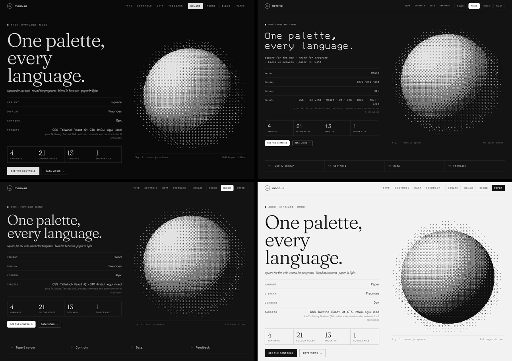

## Four versions

Square and round are the two looks I actually had. Blend mixes them, and paper is square
turned into a light theme.

| | **square** | **round** | **blend** | **paper** |
|---|---|---|---|---|
| Looks like | my websites | my desktop | a bit of both | my websites, printed |
| Light or dark | dark | dark | dark | light |
| Background | `#0a0a0a` | `#131313`, panels `#1f1f1f` | same as round | `#f2f2f2`, inputs white |
| Fonts | Fraunces, Space Grotesk, Space Mono | 3270 Nerd Font | square's fonts, 3270 for code | same as square |
| Corners | none | 8px (6 small, 12 large) | 6px (4 small, 10 large) | none |
| Borders | thin, see-through | solid greys | thin, see-through | thin, see-through |
| Labels | UPPERCASE, wide spacing | normal case, bold | UPPERCASE, a bit tighter | UPPERCASE, wide spacing |

Blend is round's layered greys and soft corners with square's type on top, so it reads
like the website but sits better next to the desktop. Paper keeps everything about
square and flips it to black ink on off-white. Its code colours, terminal colours and the
dither effect are all redone for a light background rather than just inverted.

## What it covers

Everything below gets built from `tokens/mono.json` into `dist/`.

**Websites**
- plain CSS + JS (`dist/web`): about 50 component classes, switch versions with `data-mono="square"`, `"round"`, `"blend"` or `"paper"`
- Tailwind v4 and v3, Sass, and React components (`dist/webext`)

**Apps**
- Python: Qt (PySide6/PyQt6), Tkinter, Dear PyGui, Textual
- C++: Qt 6, Dear ImGui
- D and C: GTK 3
- Rust: egui, iced
- Java: Swing
- Go: Fyne
- C#: Avalonia
- QML / Quickshell
- plain constants for C, D, Python, JS/TS, Rust, Go, Lua and C# if your thing isn't listed (`dist/exports`)

**Editors**: Neovim (with treesitter, LSP and lualine), VS Code, Helix, Zed

**Terminals**: kitty, foot, Alacritty, WezTerm, Ghostty, tmux, Windows Terminal, Xresources

**Desktop**: GTK 4 / libadwaita, Waybar, Rofi, Fuzzel, Wofi, Dunst, Mako, btop, Firefox, Vencord (Discord),
plus the files my own rice uses (Hyprland, Quickshell, qt6ct, KDE colour scheme, starship)

## Screenshots

| Qt (Python) | Dear ImGui |
|---|---|
| 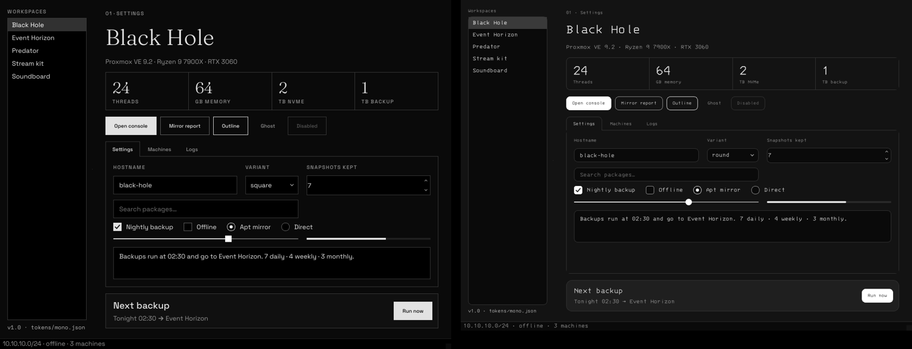 | 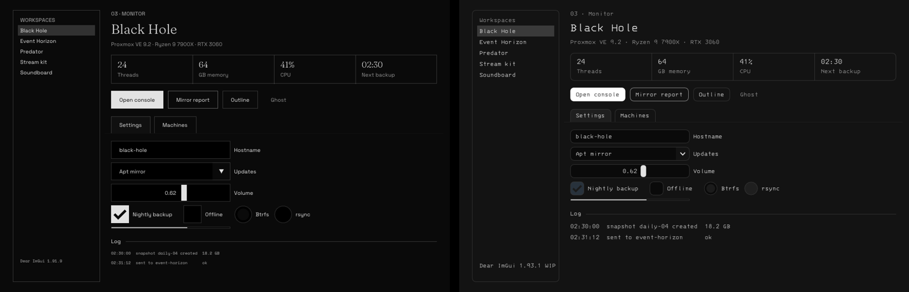 |
| **GTK from D** | **Textual** |
| 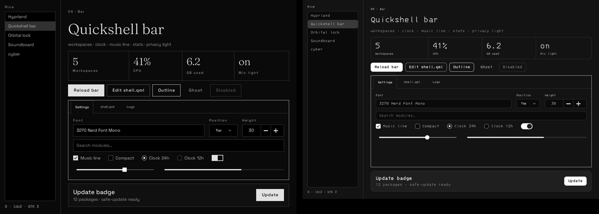 | 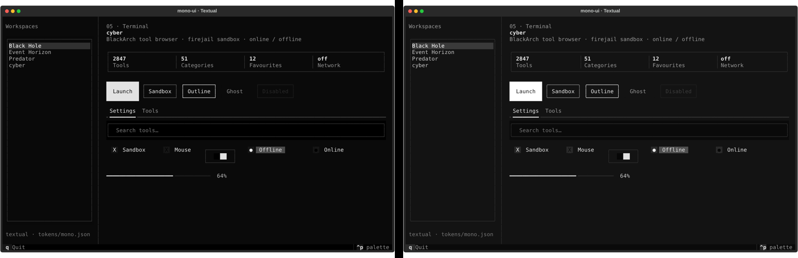 |
| **Neovim** | **Rofi + libadwaita** |
| 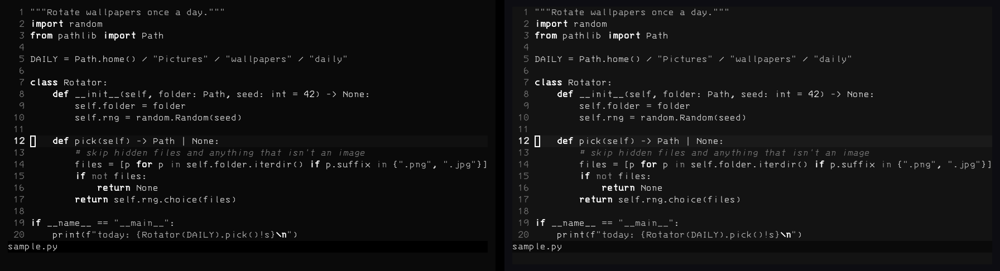 | 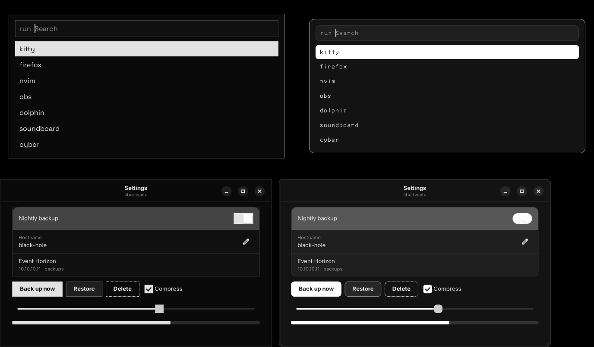 |

Square on the left, round on the right:

**egui**
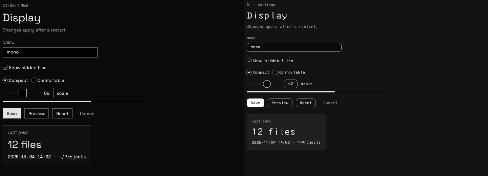

**iced**
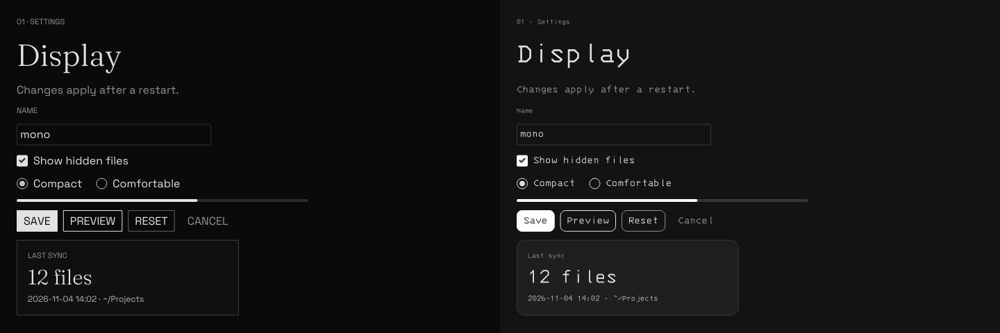

**Swing**
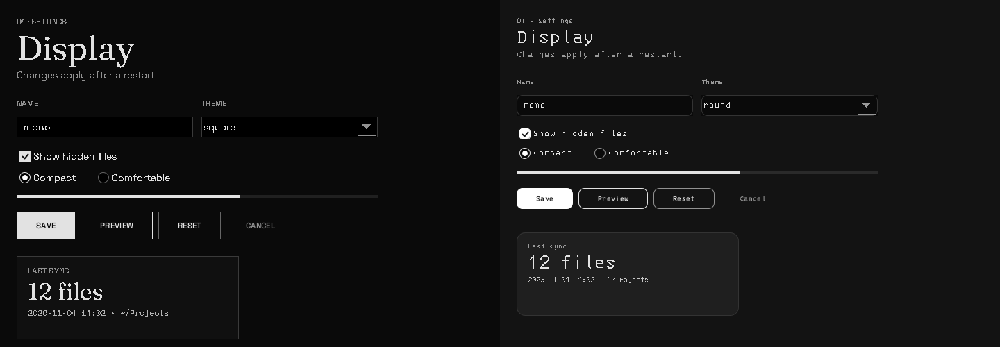

**Tkinter**
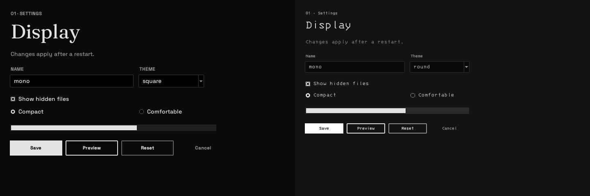

**Dear PyGui**
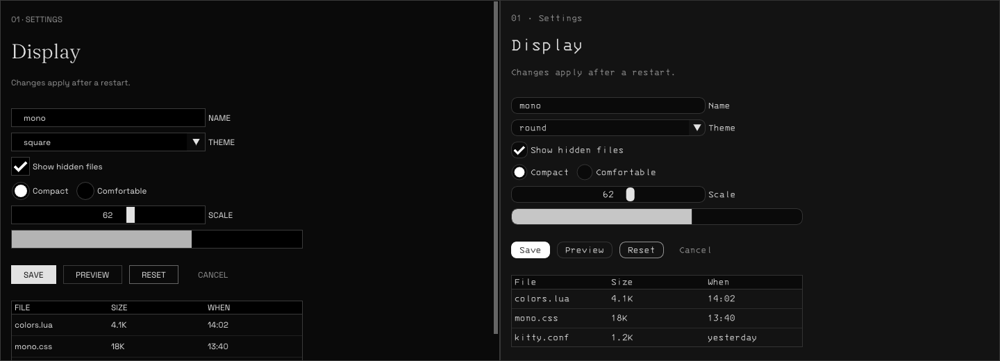

Blend on the left, paper on the right:

**Qt**
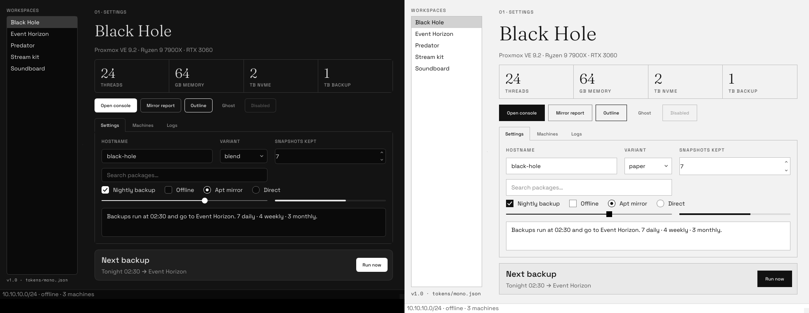

**Tkinter, Swing and Dear PyGui**
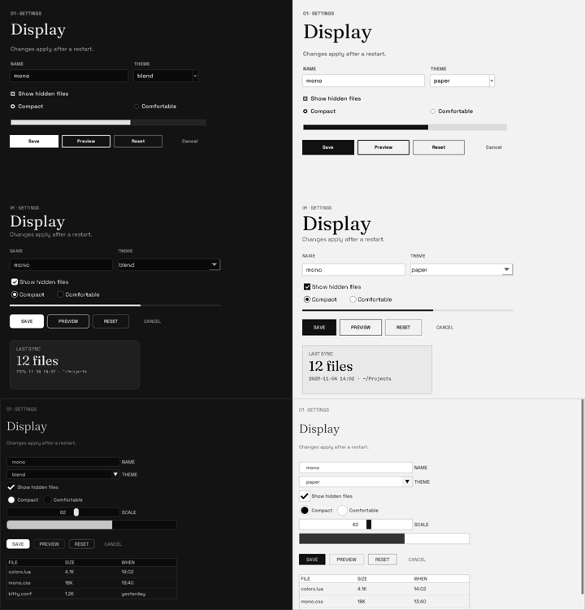

**egui and iced**
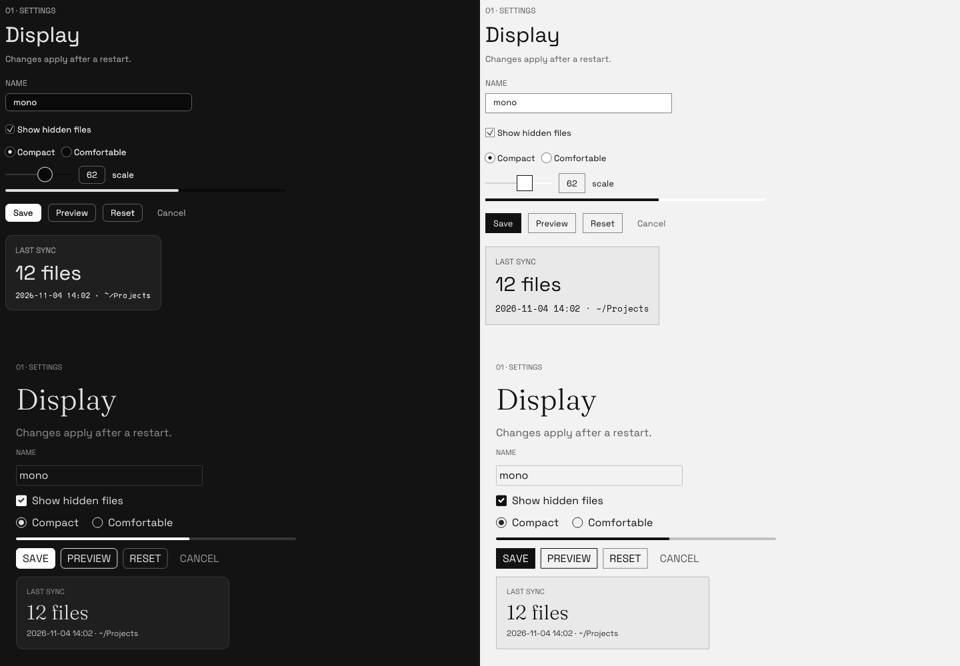

More in [docs/screenshots](docs/screenshots).

## Using it

You don't need to build anything. `dist/` is committed, so clone and point at the file you need.

### Web

```html
<link rel="stylesheet" href="dist/web/mono.css">
<html data-mono="square">   <!-- or round, blend, paper. works on any element, not just <html> -->

<button class="m-btn fill">Save</button>
<input class="m-input" placeholder="Name">
```

The main classes: `m-btn` (with `fill`, `line`, `ghost`, `arrow`, `small`, `big`), `m-input`, `m-select`,
`m-check`, `m-switch`, `m-card`, `m-stats`, `m-kv`, `m-tabs`, `m-table`, `m-status`, `m-progress`, and
`m-h1`/`m-h2`/`m-label`/`m-mono` for text. `examples/web/index.html` shows all of them (serve the
repo root with `python3 -m http.server` and open it).

`mono.js` has `setVariant()` and the Bayer dither effect from my sites.

**Tailwind v4**
```css
@import "tailwindcss";
@import "./dist/web/mono.css";
@import "./dist/webext/tailwind/mono.tailwind.css";
```
Then `bg-mono-surface text-mono-fg border-mono-line rounded-mono-md font-mono-display` and so on.
They read the CSS variables, so `data-mono` still switches them. For v3 use `presets: [require("./dist/webext/tailwind/mono.preset.js")]`.

**Sass** (needs Dart Sass, `sassc` won't work)
```scss
@use "dist/webext/scss/mono" as m;
.panel { background: m.color(surface); @include m.label; }
```

**React**: copy `dist/webext/react/MonoUI.tsx` into your project (only needs React, no other packages).
```tsx
<MonoRoot variant="round">
  <Button kind="fill">Save</Button>
  <Card><Stats items={[{ value: 12, label: "files" }]} /></Card>
</MonoRoot>
```

### Python

**Qt**
```python
from mono_qt import apply, role, kind      # dist/qt/python
apply(app, "round")
role(QLabel("Settings"), "h2")
kind(QPushButton("Save"), "fill")
```

**Tkinter**
```python
from mono_tk import apply                  # dist/apps/tkinter
root = tk.Tk()
apply(root, "square")
ttk.Button(root, text="Save", style="Fill.TButton")
ttk.Label(root, text="Settings", style="H1.TLabel")
```
Tk can't do rounded corners, so round and blend only change the colours and fonts there.

**Dear PyGui**
```python
import mono_dpg                            # dist/apps/dearpygui
themes = mono_dpg.apply("round")
dpg.add_button(label="Save"); dpg.bind_item_theme(dpg.last_item(), themes["fill"])
```

**Textual**
```python
from mono_textual import MonoApp           # dist/textual
class MyApp(MonoApp): ...
MyApp(variant="round").run()
```

### C++

**Qt**
```cpp
#include "mono_qt.hpp"                     // dist/qt/cpp
monoui::apply(app, monoui::Variant::Round, "path/to/mono-ui/fonts/ttf");
monoui::setKind(saveButton, "fill");
```

**Dear ImGui** (1.91 to 1.93)
```cpp
#include "mono_imgui.h"                    // dist/imgui
MonoUI::ApplyStyle(MonoUI::Round);
MonoUI::LoadFonts("path/to/mono-ui/fonts/ttf");
if (MonoUI::ButtonFill("Save")) { ... }
```

### Rust

Both are single files. Copy them into your crate or use `#[path]` like the examples do.

**egui** (0.37)
```rust
mono_egui::apply(ctx, mono_egui::Variant::Round);
mono_egui::load_fonts(ctx, mono_egui::Variant::Round, "path/to/mono-ui/fonts/ttf");
if mono_egui::button_fill(ui, "Save").clicked() { ... }
```

**iced** (0.14)
```rust
fn theme(&self) -> Theme { mono_iced::theme(mono_iced::Variant::Round) }
button("Save").style(mono_iced::button_fill)
container(content).style(mono_iced::card)
```

### Other languages

**D / C with GTK 3**: `dist/gtk/d/monoui/gtk.d` or `dist/gtk/c/mono_gtk.h`. Works with or without GtkD.
```d
import monoui.gtk;
apply(Variant.round, "path/to/mono-ui/fonts/ttf");
addClass(button.getWidgetStruct(), "fill");
```

**Java Swing**: `dist/apps/swing/monoui/MonoUI.java`
```java
MonoUI.apply(MonoUI.Variant.ROUND, Path.of("mono-ui/fonts/ttf"));   // before you make any components
JButton save = MonoUI.button("Save", MonoUI.Kind.FILL);
JPanel card = MonoUI.card();
```

**Go Fyne**: `dist/apps/fyne/monotheme`
```go
a.Settings().SetTheme(monotheme.New(monotheme.Round))
```

**C# Avalonia**: add `dist/apps/avalonia/MonoRound.axaml` (or `MonoSquare`, `MonoBlend`, `MonoPaper`) after `<FluentTheme />` in
your `App.axaml`, then use classes like `<Button Classes="fill">` and `<Border Classes="card">`.

**QML / Quickshell**
```qml
import "path/to/mono-ui/dist/qml/MonoUI"
Rectangle { color: Mono.surface; radius: Mono.radiusMd; border.color: Mono.line }
```

Everywhere a variant is picked, the same four names work: `"square"`, `"round"`, `"blend"`,
`"paper"` in strings, and `Square`/`Round`/`Blend`/`Paper` (or `SQUARE`... in Java) in enums.
Every file below that ends in `-round` also comes as `-square`, `-blend` and `-paper`.

### Editors

- **Neovim**: copy `dist/editors/nvim/colors` and `lua` into `~/.config/nvim/`, then `:colorscheme mono-round`.
  Lualine: `theme = "mono_round"`.
- **VS Code**: copy `dist/editors/vscode` to `~/.vscode/extensions/mono-ui`, restart, pick "Mono Square", "Mono Round", "Mono Blend" or "Mono Paper".
- **Helix**: copy the files from `dist/editors/helix/themes` to `~/.config/helix/themes/`, then `theme = "mono-round"`.
- **Zed**: copy `dist/editors/zed/themes/mono.json` to `~/.config/zed/themes/`.

### Terminals

Each file has a comment at the top saying where it goes. Short version:

- **kitty**: `include mono-round.conf`
- **foot**: `include=~/.config/foot/mono-round.ini`
- **Alacritty**: `import = ["~/.config/alacritty/mono-round.toml"]` (on 0.14+ put it under `[general]`)
- **WezTerm**: `config.colors = dofile(".../mono-round.lua")`
- **Ghostty**: copy to `~/.config/ghostty/themes/`, then `theme = mono-round`
- **tmux**: `source-file ~/.config/tmux/mono-round.conf`
- **Windows Terminal**: paste the entries from `mono-schemes.json` into `"schemes"`

### Desktop

All in `dist/desktop`, one file per version, with setup notes at the top:
GTK 4 / libadwaita (`~/.config/gtk-4.0/gtk.css`), Waybar, Rofi, Fuzzel, Wofi, Dunst, Mako, btop,
Firefox `userChrome.css`, and a Vencord theme for Discord.

### My rice

`dist/rice` writes the same files my desktop already uses, in the same format.
Right now they come out byte-for-byte the same as the ones in magginephew-rice, so you can
check nothing broke with a diff.

```sh
gen/install-rice.sh            # dry run, shows what would change
gen/install-rice.sh --apply    # backs up to ~/.config/mono-ui-backup-<date> first, then copies
```

`hypr/colors.lua` and `quickshell/colors.qml` are normally made by matugen, so running
matugen again (like when the wallpaper changes) will overwrite them.

## Fonts

`fonts/ttf` is for apps and `fonts/woff2` is for the web. Most of the app helpers load the TTFs
themselves if they aren't installed. To install them for the whole system:

```sh
cp fonts/ttf/*.ttf ~/.local/share/fonts/ && fc-cache -f
```

The 3270 Nerd Font web version is split in two so a page only downloads the icon part
(about 1 MB) when it actually shows an icon.

## Changing the theme

1. Edit `tokens/mono.json`. Colours can point at each other, like `"gray.900"`,
   `"alpha(gray.900, 0.22)"` or `"mix(gray.100, gray.900, 0.05)"`.
2. Run `python3 gen/build.py`. To build only some things: `python3 gen/build.py web editors`.
3. Reload whatever you're using.

The build only needs Python 3.10 or newer, nothing to install.

How it's laid out:
- `tokens/mono.json` has all the values
- `gen/targets/` has one Python file per group of outputs (web, qt, apps, editors, terminals, desktop, ...)
- `gen/templates/` has the hand-written parts (component CSS, Qt and GTK stylesheets, React components)
- `examples/` has the same demo screen in each toolkit. They all take `square`, `round`, `blend` or `paper` as the first argument.

## Examples

| | how to run |
|---|---|
| `examples/web` | serve the repo root and open `examples/web/index.html` |
| `examples/python-qt` | `python3 demo.py round` (needs PySide6) |
| `examples/cpp-qt` | `cmake -B build && cmake --build build && ./build/mono_qt_demo round` |
| `examples/cpp-imgui` | clone imgui into the folder, then `cmake -B build && cmake --build build` (needs glfw) |
| `examples/d-gtk` | `dub run -- round` (needs ldc or dmd and gtk3) |
| `examples/python-textual` | `python3 demo.py round` (needs textual) |
| `examples/qml` | `python3 demo.py round` (needs PySide6) |
| `examples/tkinter` | `python3 examples/tkinter/demo.py round` |
| `examples/dearpygui` | `python3 examples/dearpygui/demo.py round` (needs dearpygui) |
| `examples/swing` | `javac -d build dist/apps/swing/monoui/MonoUI.java examples/swing/Demo.java && java -cp build Demo round` (from the repo root) |
| `examples/egui` | `cargo run -- round` |
| `examples/iced` | `cargo run -- round` |

## What's actually been tested

I've run these and looked at them:
- web in Chromium, Tailwind v3 and v4, Dart Sass, React (type-checked and rendered)
- Qt 6 from C++ and PySide6, Qt Quick, Dear ImGui 1.91 and 1.93, GTK 3 from D and C, Textual
- Tkinter, Dear PyGui 2.3, Swing on Java 21, egui 0.37, iced 0.14
- Neovim 0.9, Alacritty, tmux, Rofi, Dunst, GTK 4.14 with libadwaita 1.5
- VS Code, Zed, Helix and Windows Terminal files parse, and the Waybar and Wofi CSS load in GTK without errors
- blend and paper on all of the above that I could run: web, Qt (Python and C++), GTK from D and C, Dear ImGui,
  Tkinter, Swing, Dear PyGui, egui, iced, Neovim, tmux, Rofi, Sass, and the C, D, Rust, Go, Lua, JS and Python constants

Not tested yet, so these might need fixing:
- Fyne and Avalonia (couldn't download their packages where I built this)
- the C# constants (generated but never compiled)
- Ghostty, Mako, btop, Fuzzel, Firefox and Vencord

If one of these is broken, open an issue or a PR.

## Contributing

Change `tokens/mono.json` or the files in `gen/`, never `dist/` directly, since `dist/` gets
overwritten on every build. Run `python3 gen/build.py` and commit both. CI checks that
`dist/` matches what the build makes.

To add another variant, copy one of the blocks under `variants` in `tokens/mono.json`, give
it a new name and change what you want. A light one needs `"mode": "light"` and its own
`terminal`, `editor` and `syntax` sections (look at paper). You don't need to touch `gen/`;
every target picks it up on the next build.

To add a new target, add a file in `gen/targets/` with a `build(tokens, out)` function that
returns the files it wrote, and add its name to `TARGETS` in `gen/build.py`.

## License

The code is MIT (see [LICENSE](LICENSE)). The fonts keep their own licence, the SIL Open Font
License, with copies in `fonts/licenses`.
